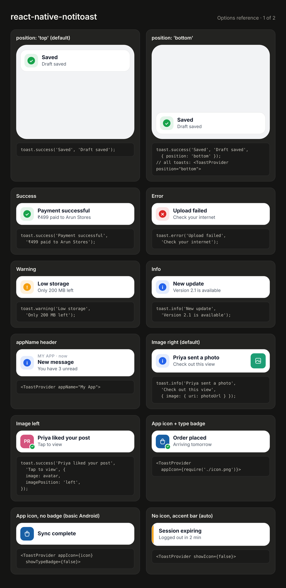
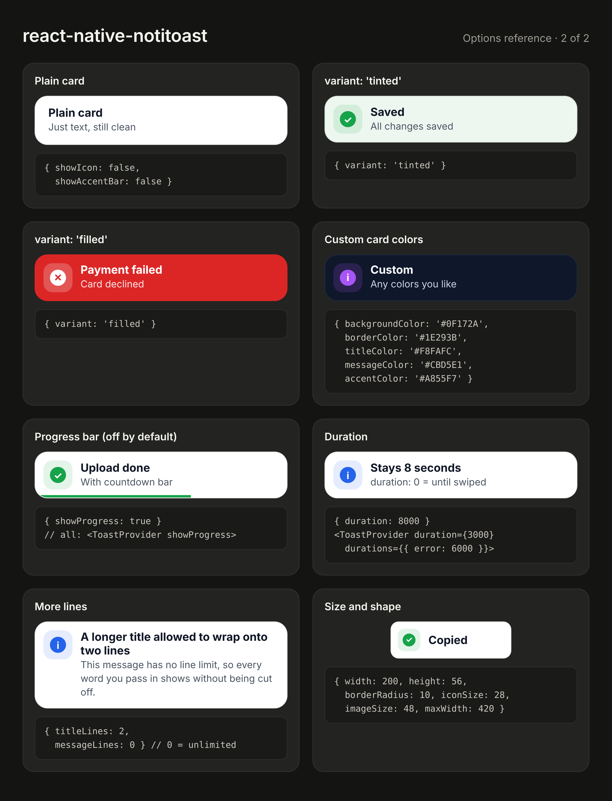

# react-native-notitoast

Neat, **mobile-notification-style** toasts for React Native — success, error, warning and info, with images, app icon, variants and full customization.
Zero dependencies · TypeScript · Expo & bare RN · light/dark mode · swipe to dismiss.




## Install

```sh
npm install react-native-notitoast
```

Requires `react-native >= 0.72`. Works in Expo Go — no native code.

## Setup

```tsx
import { ToastProvider } from 'react-native-notitoast';

export default function App() {
  return (
    <ToastProvider>
      <RootNavigator />
    </ToastProvider>
  );
}
```

## Usage

```tsx
import { toast } from 'react-native-notitoast';

toast.success('Payment successful', '₹499 paid to Arun Stores');
toast.error('Upload failed', 'Check your internet connection');
toast.warning('Low storage', 'Only 200 MB left on device');
toast.info('New update', 'Version 2.1 is available');
```

Every option below works **globally** (as a `<ToastProvider>` prop) and **per toast** (third argument). Per-toast values win.

## Customization recipes

### Image left or right

```tsx
toast.info('Priya sent a photo', 'Check out this view!', {
  image: { uri: 'https://example.com/photo.jpg' },
  imagePosition: 'left', // default 'right'
});
```

A left image takes the icon's place, with a small type badge on its corner (`showTypeBadge: false` to remove).

### App icon (basic Android-toast style)

```tsx
<ToastProvider appIcon={require('./assets/icon.png')}>
```

Leave `appIcon` unset and nothing shows there.

### No icons — still clean

```tsx
<ToastProvider showIcon={false}>
```

Without a left icon, a thin colored accent stripe marks the type automatically. Turn that off too with `showAccentBar: false` for a plain text card.

### Duration

```tsx
<ToastProvider duration={3000} />                       // all toasts
<ToastProvider durations={{ error: 6000, success: 2000 }} /> // per type
toast.success('Saved', undefined, { duration: 1500 });   // one toast
toast.info('Read me', 'Stays until closed', { duration: 0 }); // sticky
```

Defaults: error 5000ms, warning 4000ms, success/info 3500ms.

### Progress bar (off by default)

```tsx
<ToastProvider showProgress />
toast.success('Saved', 'Draft saved', { showProgress: true });
```

### Lines

```tsx
toast.info('A long title that can wrap', 'Long message…', {
  titleLines: 2,   // default 1
  messageLines: 0, // default 3, 0 = unlimited
});
```

### Size

```tsx
<ToastProvider width="90%" maxWidth={420} minHeight={64} borderRadius={14} iconSize={36} imageSize={48} />
toast.info('Fixed height', 'This one is 80px', { height: 80 });
```

### Card color and variants

```tsx
<ToastProvider variant="tinted" />   // 'default' | 'tinted' | 'filled'
toast.error('Payment failed', 'Card declined', { variant: 'filled' });

toast.info('Custom', 'Any colors you like', {
  backgroundColor: '#0F172A',
  borderColor: '#1E293B',
  titleColor: '#F8FAFC',
  messageColor: '#CBD5E1',
  accentColor: '#A855F7',
});

<ToastProvider colors={{ success: '#10B981', info: '#6366F1' }} />
```

### Update a toast in place

```tsx
const id = toast.info('Uploading…', 'Please wait', { duration: 0 });
toast.success('Uploaded', 'Your file is live', { id });
```

### Hide

```tsx
toast.hide(id);  toast.hide();  toast.hideAll();
```

Hook form: `const toast = useToast();`

## All options

### Appearance (provider **and** per toast)

| Option | Type | Default |
| --- | --- | --- |
| `position` | `'top' \| 'bottom'` | `'top'` |
| `duration` | ms, `0` = sticky | per type |
| `showProgress` | `boolean` | `false` |
| `swipeable` | `boolean` — `false` turns off all swipe directions | `true` |
| `swipeLeft` `swipeRight` | `boolean` — swipe sideways to dismiss | `true` |
| `swipeUp` | `boolean` | `true` on top toasts, `false` on bottom |
| `swipeDown` | `boolean` | `true` on bottom toasts, `false` on top |
| `showIcon` | `boolean` | `true` |
| `showTypeBadge` | `boolean` — badge on left image / app icon | `true` |
| `showAccentBar` | `boolean` | auto (on when no left icon) |
| `imagePosition` | `'left' \| 'right'` | `'right'` |
| `appIcon` | `ImageSourcePropType` | — (hidden) |
| `variant` | `'default' \| 'tinted' \| 'filled'` | `'default'` |
| `backgroundColor` `borderColor` `titleColor` `messageColor` | `string` | theme |
| `titleLines` | `number`, `0` = unlimited | `1` |
| `messageLines` | `number`, `0` = unlimited | `3` |
| `width` `maxWidth` `minHeight` `height` | number or `'%'` | `'100%'`, `560`, —, — |
| `borderRadius` | `number` | `18` |
| `iconSize` | `number` | `40` |
| `imageSize` | `number` | `44` |
| `style` `titleStyle` `messageStyle` | style overrides | — |

### Per toast only

| Option | Type |
| --- | --- |
| `type` | `'success' \| 'error' \| 'warning' \| 'info'` |
| `title`, `message` | `string` |
| `image` | `ImageSourcePropType` |
| `icon` | `ImageSourcePropType` — custom left icon / avatar |
| `accentColor` | `string` |
| `id` | `string` — reuse to update |
| `onPress`, `onHide` | `() => void` |

### Provider only

| Prop | Type | Default |
| --- | --- | --- |
| `theme` | `'light' \| 'dark' \| 'system'` | `'system'` |
| `colors` | `{ success?, error?, warning?, info? }` | green / red / amber / blue |
| `durations` | `{ success?, error?, warning?, info? }` | 3500 / 5000 / 4000 / 3500 |
| `topOffset` | `number` | iOS 54, Android status bar + 8 |
| `bottomOffset` | `number` | `40` |

**Left slot priority:** left `image` → `icon` → `appIcon` → type icon → accent stripe.

**Safe area tip:** `<ToastProvider topOffset={useSafeAreaInsets().top + 8}>`

## Behaviour

- Toasts queue: one at a time, the next slides in after.
- Swipe left, right or up (down for bottom toasts) to dismiss. Turn any direction off, e.g. `swipeLeft={false}`, or all of them with `swipeable={false}`. Press and hold pauses the timer.
- Announced to screen readers.
- Toasts render behind an open React Native `<Modal>`. Put another `<ToastProvider>` inside the modal if needed.

## License

MIT
